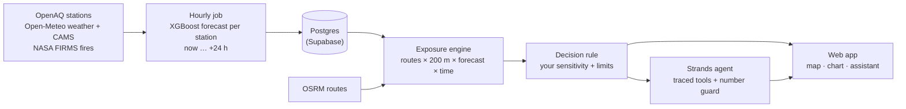

<div align="center">

# AirGuard

**Same commute. Less smoke.**

AirGuard reads the PM2.5 forecast along every route you could take in the next few hours,
then tells Delhi commuters which way to go and when to leave so they breathe less of it.

[Setup](docs/setup.md) · [How it works](docs/architecture.md) · [Method](docs/methodology.md) · [Evidence](#evidence) · [Contributing](CONTRIBUTING.md)

</div>

<!-- screenshots: docs/screenshots/*.png -->

## The problem

On bad-air days, Delhi's AQI apps show a map of numbers. They don't change what anyone does. Yet the
same trip can mean very different exposure depending on the road you take and the hour you leave:
PM2.5 swings through the day as the boundary layer rises and falls, and it varies street to street.

AirGuard is for the people who feel that difference most: people who cycle or walk to college or work,
riders on two-wheelers, people with asthma, and parents on the school run.

## What it does

- **Compares real routes** for walking, cycling, two-wheelers or a car, each coloured every 200 m by
  forecast PM2.5 along the way.
- **Finds a better time to leave**, checking every 15 minutes over the next few hours.
- **Fits your limits.** You say how sensitive you are and how much extra time you'll accept; it never
  suggests more. Sensitivity changes the trade-off, never the pollution numbers.
- **Explains itself.** An assistant built on the **Strands Agents SDK** answers follow-up questions using
  only numbers its tools return. Every tool call is visible, and every number is checked before you see it.
- **Says how sure it is.** Every exposure figure carries a forecast range and a confidence score; stations
  whose feeds are delayed are marked as estimates.

## How it works



1. **Forecast.** Each hour, one XGBoost model per horizon forecasts PM2.5 at ~75 stations from their recent
   readings, neighbouring stations, the CAMS global model, weather (incl. boundary-layer height) and crop
   fires detected upwind.
2. **Score.** Each candidate route is cut into 200 m segments; each segment gets the forecast for the minute
   you'd reach it, blended from the nearest stations.
3. **Decide.** Every route × every 15-minute departure is scored; the recommendation is the lowest-exposure
   option whose exposure saving is worth its extra time to you.
4. **Explain.** The assistant reads the saved analysis through tools and explains the trade-off.

Details and every assumption: [docs/methodology.md](docs/methodology.md).

## Evidence

<!-- evidence-table -->

The forecast is tested on the most recent two weeks, which it never saw in training, against three
baselines. The full results, including the delayed-feed mode, are on the app's **Evidence** page.

## Quick start

You need Python 3.12, Node 20+, Docker or Podman, and optionally Ollama. One free key:
[OpenAQ](https://explore.openaq.org/register).

```bash
make setup                       # Python venv, npm install, pulls the local LLM (qwen3:1.7b)
echo "OPENAQ_API_KEY=..." >> .env.local
make db-start                    # local Supabase + migrations
make backfill                    # ~20 min: a year of station, weather, CAMS and fire data
make train                       # trains the models and writes the backtest
make forecast                    # issues the current forecast
make dev                         # API on :8000, web app on :3000
```

Full guide, phone testing and troubleshooting: [docs/setup.md](docs/setup.md).

## Built with AWS open source

- **[Strands Agents SDK](https://strandsagents.com)** runs the assistant: tool selection, streaming and
  the agent loop. Locally it drives a small Ollama model; deployed, the same code uses **Amazon Bedrock**
  (Amazon Nova).
- Deployment plan: FastAPI on **AWS Lambda** behind **API Gateway**, the hourly job on **EventBridge**,
  model files in **S3**, secrets in **SSM Parameter Store**, web app on **Amplify Hosting**.

## Project layout

```
backend/airguard/   engine/ (pure exposure maths) · ml/ · ingestion/ · services/ · agent/ · api/ · jobs/
backend/tests/      engine and guard unit tests
frontend/           Next.js app (landing, onboarding, planner, evidence, method)
supabase/           migrations/ (source of truth) · setup.sql (generated, paste-ready)
contracts/          openapi.json (frontend types are generated from it)
docs/               architecture, methodology, setup, database, decisions
```

## Honest limits

- Delhi NCR has a few dozen reference monitors; most of a route is interpolated, and roadside levels can be
  higher than any station. Confidence scores say so.
- CPCB feeds on OpenAQ are sometimes delayed by hours or days; affected stations are model estimates.
- The exposure index is an estimate under stated assumptions, not a measured dose. Options are only compared
  within one mode of travel.
- Travel times are free-flow estimates without live traffic. Departures are planned up to 6 hours ahead.
- General guidance only, not medical advice.

## Data and credits

Station data from [OpenAQ](https://openaq.org) (CPCB, DPCC, IMD, state boards, AirNow, AirGradient).
Weather and CAMS air-quality data from [Open-Meteo](https://open-meteo.com) (CC BY 4.0, non-commercial
use) and [Copernicus CAMS](https://atmosphere.copernicus.eu). Fires from [NASA FIRMS](https://firms.modaps.eosdis.nasa.gov).
Map data © [OpenStreetMap contributors](https://www.openstreetmap.org/copyright); routing by
[OSRM / FOSSGIS](https://routing.openstreetmap.de); search by [Photon](https://photon.komoot.io); tiles by
[OpenFreeMap](https://openfreemap.org).

## License

[MIT](LICENSE)
