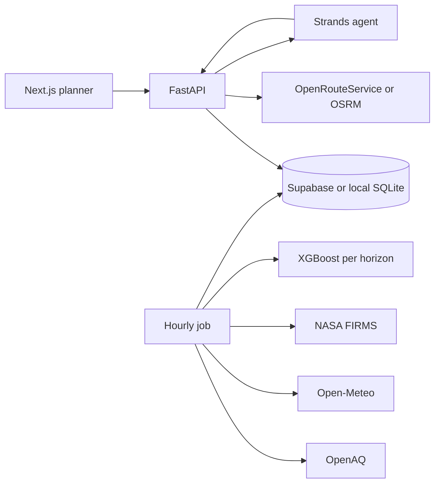

# AirGuard

AirGuard helps a Delhi commuter pick a route and a departure time that lower estimated PM2.5 exposure. The forecast carries an uncertainty range. An agent explains the trade-off, and every number it states comes from a tool.

The route difference is an estimate under stated assumptions. It is not a measurement of what a person inhaled. Station forecasts are scored separately with MAE and RMSE on a time-based holdout.

## Run it in 5 minutes

Requirements: Python 3.10 or newer, and Node 20 or newer. This repo's virtualenv was created with Python 3.10 because that is the newest installed interpreter with wheels for the ML and agent libraries.

```bash
python3.10 -m venv .venv
source .venv/bin/activate
pip install -r requirements-dev.txt
cp .env.example .env
PYTHONPATH=. python scripts/seed_local.py
```

The seed writes synthetic station history, trains `models/synthetic-v1`, fills the local SQLite database, and writes `frontend/public/demo/trip1.json`. Those error numbers are for local development. They are not a Delhi backtest. The evaluation page says so when the model version contains `synthetic`.

```bash
# terminal 1
uvicorn api.main:app --reload --port 8000
# terminal 2
cd frontend && npm install && npm run dev
```

Open http://localhost:3000, leave the places as Hauz Khas and DU North Campus, and choose Compare routes. The form starts at Normal sensitivity and a 15-minute cap. On the seeded data that cap is too tight to justify waiting, so the recommendation is to leave now. Choose Sensitive and allow 30 extra minutes, or open http://localhost:3000/?offline=1, for the saved result from this seed: leave 15 minutes later for about a 21% lower exposure index. That file is synthetic. Copy `frontend/.env.example` to `frontend/.env.local` if the page cannot find the API.

```bash
pytest -q
```

## Real Delhi data

1. Run `sql/schema.sql` in a Supabase project with PostGIS, then set `SUPABASE_URL` and `SUPABASE_SERVICE_KEY`.
2. Set `OPENAQ_API_KEY`. `FIRMS_MAP_KEY` and `ORS_API_KEY` are optional. Fires stay zero without a FIRMS key. Routing falls back to a saved geometry or the public OSRM demo without an ORS key.
3. `PYTHONPATH=. python scripts/backfill.py`
4. `MODEL_VERSION=v1 python -m ml.train`
5. `MODEL_DIR=models/v1 PYTHONPATH=. python scripts/run_hourly.py --once`
6. On the morning of a demo, `PYTHONPATH=. python scripts/snapshot.py` and quote only `docs/headline.json`.

`python scripts/live_check.py` scores forecasts the hourly job actually stored, which is separate from the backtest. The backtest uses archived weather. The live job, when a key is set, uses the Open-Meteo forecast API for recent hours.

## Architecture



The exposure engine is pure Python. It does not call the network. The agent is not allowed to invent a concentration, a minute count, or a percentage.

## Assumptions

| Choice | Value |
| --- | --- |
| Modes | walk 1.0, cycle 1.6, car 0.5 relative intake per minute |
| Segments | about 200 m, speed taken from the route duration |
| Interpolation | inverse distance, power 2, 4 nearest stations |
| Levels | 30 / 60 / 90 / 120 / 250 µg/m³, AirGuard labels, not official AQI |
| Reliability | 0.6 distance + 0.4 interval width, a heuristic, not a probability |
| Decision | normal / sensitive / high accept 4 / 7 / 10 extra minutes per 10% exposure reduction |
| Departure | every 15 minutes for 4 hours by default, up to 6 |

Sensitivity does not change the exposure index. It changes which option the decision rule may recommend. Compare options inside one mode. The about page reads the live values from `GET /config`.

## API

`GET /health`, `GET /config`, `GET /geocode`, `GET /forecast`, `POST /routes/score`, `POST /departure/best`, `POST /trips/analyze`, `POST /agent/chat`, `GET /eval`.

Coordinates outside the Delhi NCR box (lat 28.2–29.0, lon 76.7–77.7) are rejected. Errors use `{"error": {"code", "message"}}`. The OpenAPI document is `contracts/openapi.json`.

## AWS

Deploy only after the local demo works. `infra/template.yaml` is one container image with the API, the agent, and the hourly job. Use `us-east-1`, keep secrets in SSM under `/airguard/`, and avoid NAT gateways, always-on instances, and SMS. The frontend is a static export (`frontend/out`) and can be hosted on Amplify with `amplify.yml`.

Strands Agents SDK is the agent framework. Local development uses Ollama (`LLM_BACKEND=ollama`). The deployed template points the agent Lambda at Amazon Bedrock.

## Limits

Station coverage in Delhi is sparse, so a route far from sensors gets a low reliability score. The engine assumes a steady speed and ignores street-level differences. It does not plan a trip for a chosen clock time such as tomorrow at 8 AM. It compares leaving now with waiting.
