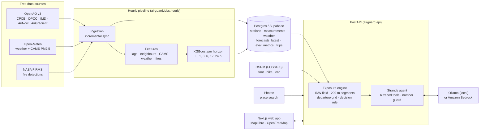

# Architecture

AirGuard has two paths: an **hourly pipeline** that keeps station forecasts fresh, and a **trip
path** that turns those forecasts into route and departure advice on request.

## Principles

1. **Numbers come from code.** The forecast model, interpolation and exposure maths are deterministic.
   The language model only picks tools and explains their output, and every number it writes is checked
   against those outputs before the user sees it.
2. **The engine is pure.** `airguard/engine` has no network or database access and is covered by unit
   tests, including a route checked by hand.
3. **Honest uncertainty.** Every station forecast has an 80% range; every route has a confidence that
   falls with distance from monitors and with forecast width. Delayed feeds are labelled as estimates.
4. **Cache what's public.** Routes and place searches are cached in Postgres so a demo never depends on a
   public server being up.

## Request path for one trip

1. The web app sends `POST /trips/analyze` with origin, destination, mode and the user's profile.
2. `services.routing` returns up to three distinct OSRM routes (alternatives, or via-point detours).
3. `engine.exposure.prepare` cuts each route into 200 m segments and pre-computes distances to every station.
4. `engine.departure.evaluate` scores every route at every 15-minute departure in the window.
5. `engine.departure.decide` applies the user's sensitivity and limits and picks the recommendation.
6. The result is saved in `trips` and returned with a `trip_id`; the assistant reads it back with
   `get_trip_result` instead of recomputing.

## Hourly pipeline

1. `ingestion.sync.sync_measurements` fetches new hourly PM2.5 for each station since its newest stored hour.
2. `ingestion.sync.sync_weather` refreshes weather and CAMS from 3 days back to 2 days ahead, plus upwind fires.
3. `ml.predict.run` builds features at the current hour and writes `forecasts` (history) and
   `forecasts_latest` (what the API reads).

Locally this runs with `make hourly`. On AWS the same `run()` is an EventBridge-scheduled Lambda.

## Code map

| Path | What lives there |
| --- | --- |
| `backend/airguard/engine/` | Pure exposure engine and every modelling assumption |
| `backend/airguard/ml/` | Features (shared by training and serving), training + backtest, prediction |
| `backend/airguard/ingestion/` | OpenAQ, Open-Meteo and FIRMS clients; incremental sync |
| `backend/airguard/services/` | Routing, geocoding, forecast access, trip analysis |
| `backend/airguard/agent/` | Strands agent, tools, tracing, number guard, deterministic fallback |
| `backend/airguard/api/` | FastAPI app and request/response schemas |
| `backend/airguard/jobs/` | CLI jobs: backfill, hourly, snapshot |
| `frontend/src/app/` | Pages: landing, onboarding, planner, evidence, method |
| `frontend/src/components/` | Map, planner panels, assistant, design-system pieces |
| `supabase/migrations/` | Schema history; `supabase/setup.sql` is generated from it |
| `contracts/openapi.json` | API contract; frontend types are generated from it |
